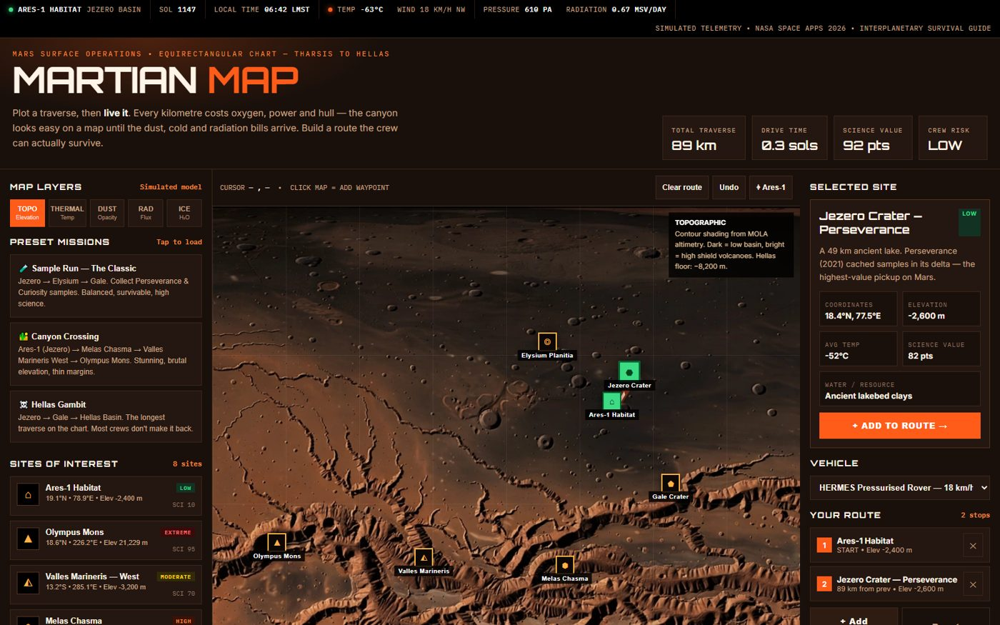
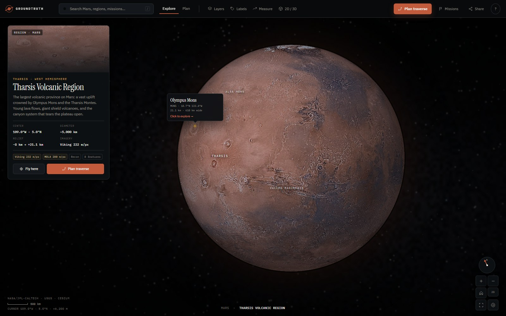

# Groundtruth — Mars Orbital Atlas

**Build plan v2 · 14 Nov 2026**

> **Build status:** baseline implemented and production build verified — Cesium Mars globe, sparse starfield, real-time Mars24 sun/terminator with even-light toggle, MOLA relief, sector hover/search, editable Gale A* route builder, safety envelope, Walk mode, and the Orbital UI. The sections below are the design reference and record the decisions that shaped it; 3D terrain remains deferred (§8.9).
>
> **v3 direction — 15 Nov 2026:** the Plan tab and the FieldAtlas route-builder flow are **superseded**. The replacement is the gamified astronaut planner in [`PLAN-V3.md`](PLAN-V3.md). Do not extend the old Plan flow; reuse only its data, A* engine, safety math, and POV content.

---

## 0. Executive summary

| Decision | Choice |
|---|---|
| **Product** | **Groundtruth** — a Google Earth–style Mars atlas with mission-planning tools. |
| **Default view** | 3D Mars globe, real star field, named sectors, hover highlight, click-to-zoom. |
| **3D terrain** | **Deferred.** v1 is a smooth ellipsoid; a local Gale heightmap is a post-core add with hooks in §8.9. |
| **Engine** | **CesiumJS** (`Ellipsoid.MARS`, EPSG:104905) for the globe; **Leaflet** for the Gale field atlas. |
| **Global content** | 34 named regions, 30 MC quadrangles, 8 major features, 1,794 named features, 8 landing sites, 4 rover traverses, global Viking/MOLA imagery. |
| **Deep planning** | **Gale Crater / Hematite Ridge** — real 1 m DEM, HiRISE, A* routing, safety envelope, field notes. |
| **Planning elsewhere** | **Recon traverse** on the globe: great-circle distance/bearing, no terrain model. |
| **UI** | Dark **Orbital** chrome: 56 px top ribbon, search at left, tools centre, planning at right, compass/zoom bottom-right. |
| **Deadline assumption** | README says **Sun 15 Nov 2026, 23:59 IST** — roughly 27 hours. Scope is sized for that. |

**The product sentence:** *Open Mars. Find a place. Understand it. Plan the walk.*

**Why Cesium:** Cesium has a built-in `Ellipsoid.MARS` tied to **EPSG:104905** — the exact Mars Equirectangular CRS used by NASA's Mars Trek services. That means the globe, the sector polygons, the rover traverses, and the Gale imagery all share one coordinate system. It also ships a real Tycho-2 star field, camera flights, entity picking, labels with distance conditions, and a compass/navigation model. Rebuilding that in Three.js would consume the whole build window.

---

## 1. The challenge, decoded

### 1.1 The ask

From the official Details tab:

> "Create a layered, integrated view of a location or route on the Martian surface that pulls together data from multiple NASA science missions and could help a human explorer plan and carry out a successful Marswalk while conducting new and exciting science along the way."

Supporting requirements and suggestions:

- At least **three kinds of data** — optical, thermal, spectral, topographic, geophysical, atmospheric, radiation, chemical.
- NASA's first priority is **astronaut safety**: radiation, obstacles, suit mobility, equipment loads.
- A **route map** that shows where the astronaut will travel while avoiding significant obstacles such as large rock formations.
- **Point-of-view imagery** so the astronaut knows what to expect on arrival.
- A **science objective** and a location chosen for it (the brief's worked example is boxwork formations at Mount Sharp).
- Possible formats: habitat display, tablet, suit HUD, or another format.
- Rovers or robotic systems may support the crew; astronauts may work in pairs.

### 1.2 What the brief does *not* ask for

- Oxygen / power / water resource management as a game loop.
- A global atlas *instead of* a local plan. The brief says existing tools are built for regional/global views, not the hyperlocal scale of a spacewalk.
- A fictional habitat or fictional telemetry.
- "Science points" as an arbitrary score.

**How v2 reconciles "integrate it all":** the globe is the integration layer — every region, mission, and traverse in one place. The field atlas is the depth layer — a real EVA plan where the data supports it. The app does not pretend that 1 m terrain exists everywhere.

### 1.3 Resources tab — audit

| Resource | What it actually provides | How we use it | Caveat |
|---|---|---|---|
| [JPL Mars Trek](https://trek.nasa.gov/mars/) | ArcGIS services: global Viking/MOLA, Gale 1 m DEM, HiRISE, regions, nomenclature, landing sites, traverses | Primary data source for the globe and the field atlas | Some layers are blank at Gale (e.g. CRISM). |
| [USGS–NASA Planetary Geologic Mapping](https://astrogeology-usgs.hub.arcgis.com/pages/interactive-maps-mars) | Standardised global geologic map | Geologic-units overlay in the Gale field atlas. | Coarse at Gale: two units. |
| [Curiosity route animation](https://science.nasa.gov/resource/curiositys-proposed-path-up-mount-sharp/) | Route-map visual language for Mount Sharp | Reference for traverse rendering and field notes. | Inspiration, not data. |
| [NASA Worldview](https://worldview.earthdata.nasa.gov/) | Layered satellite view of **Earth** | Interaction reference for layer toggling. | Earth-only; do not present as Mars. |
| [Perseverance raw images](https://mars.nasa.gov/mars2020/multimedia/raw-images/) | 1M+ rover images with a JSON API | Jezero landing-site gallery and POV pattern. | Perseverance is at Jezero; do not mislabel as Gale. |

### 1.4 Traceability matrix

| Brief requirement | Groundtruth answer |
|---|---|
| Layered, integrated view of a location/route | Global globe with sector layers + Gale field atlas with four real data layers. |
| Data from multiple NASA missions | MRO/HiRISE, MGS/MOLA, Mars Express HRSC, MSL/Curiosity, Perseverance, Viking, Pathfinder, Spirit, Opportunity, Phoenix, InSight, USGS. |
| At least 3 data types | Optical, topographic, geologic, atmospheric (4). Radiation modelled and labelled. |
| Help plan and carry out a Marswalk | Globe recon + Gale A* planner + leg-by-leg Walk mode. |
| Safety: radiation, obstacles, suit mobility | Slope-aware routing, dose budget, thermal window, turn-back point. |
| Route avoiding obstacles | A* on the real 1 m DEM; no-go above 25°, penalty above 15°. |
| POV imagery | Curiosity Mastcam/Mars Trek images at real waypoints; Perseverance gallery at Jezero. |
| Science objective | Hematite/water story at Vera Rubin Ridge + Hematite Hotspot. |
| Rover support | Pressurised rover is the EVA base, shelter, and return cache. |
| Display format | Responsive globe/tablet UI; full-screen field atlas and Walk mode. |

---

## 2. What we have now — reference audit

The repo is two commits, a README, and one 1.1 MB self-contained `martian-map.html` (479 lines; a 1 MB base64 WebP basemap is embedded on line 201). It is a useful prototype, but most of its data claims do not survive inspection.



### 2.1 What works

- **Haversine distance** with Mars radius 3,389.5 km — correct and reusable.
- **Real place names and some real coordinates** — Jezero, Gale, Elysium, Olympus, Hellas.
- **Preset missions and a mission log** — good bones for a field workflow.
- **Map central** — the right instinct, badly implemented.

### 2.2 What must not carry over

| Current element | Problem | Verdict |
|---|---|---|
| CSS-filter "layers" | Display filters over one image, explicitly "simulated" and "display only". No data. | **Discard.** |
| Marker positions | Hand-placed percentages. The app's own cursor transform puts Elysium (135.6°E) at ~87.7% x; the marker sits at 57%. | **Replace** with georeferenced entities. |
| Basemap | One static image with `object-fit: cover`; markers drift with aspect ratio. | **Replace** with a 3D globe and a real CRS. |
| Elevation | Hand-assigned sites; custom-waypoint/cursor elevation is a sine function. | **Replace** with the real DEM. |
| Survival budget | Arbitrary O₂/power/water coefficients and a fixed "simulated weather" state. | **Replace** with a real EVA safety envelope. |
| Science value | Arbitrary points. | **Replace** with objectives, dwell time, priority. |
| UI | Dark brown/orange, Orbitron, emoji, game language, hero header. | **Replace** with Orbital. |
| Architecture | Single HTML file, no build, no tests, no provenance. | **Replace** with typed, componentised app. |

### 2.3 The credibility gap

The current app *looks* like a data tool but admits in its own UI that the layers are "simulated" and "display only". A judge who opens DevTools finds one image and some CSS filters. The new app must make the opposite impression: every visual layer traceable to a service, a resolution, and a processing step.

---

## 3. Product concept

### 3.1 Name and one-liner

**Groundtruth** — *Mars, from orbit to footstep.*

Default: a Mars globe you can spin, search, and descend into. Planning: a real field atlas for a real place.

### 3.2 Core loop

1. **Orbit** — open on a lit Mars globe against real stars. Drag to rotate; scroll to zoom.
2. **Find** — hover a sector to highlight it; click to fly in. Search for a region, feature, mission, or landing site.
3. **Understand** — sector card: name, type, coordinates, imagery resolution, data coverage, short field description.
4. **Plan** — at Gale: open the field atlas, route on the real DEM, compare options, read the safety envelope. Elsewhere: recon traverse on the globe.
5. **Walk** — step through leg cards with bearings, EVA clock, dose, and POV imagery.
6. **Verify** — evidence sheet with sources, processing, and model assumptions.

### 3.3 What "integrate it all" means

| Scale | Content | Interaction |
|---|---|---|
| **Planet** | 34 named regions, 30 MC quadrangles, global Viking/MOLA imagery, real star field | Hover highlight, click fly-to, search |
| **Region** | 8 major features, 1,794 named features (level-filtered), landing sites, rover traverses | Labels by zoom; cards; fly-to |
| **Field site** | Gale: HiRISE, 1 m DEM, slope, geology, Curiosity traverse, waypoints, POV | Full EVA planning |
| **Other sites** | Jezero: landing ellipse, Perseverance POV, traverse; other landers | Recon cards; no fake terrain |

### 3.4 Scope

**Must ship**

- Cesium Mars globe with real star field, correct ellipsoid, global imagery.
- 34 region sectors + 30 quadrangle sectors (toggle); hover highlight; click fly-to.
- Zoom-dependent labels: regions → major features → nomenclature → landing sites/waypoints.
- Search box with local index (regions, features, missions, landing sites).
- Top ribbon, bottom-right compass/zoom/home/2D-3D, bottom-left scale/coords/credits.
- Sector card with imagery, description, data coverage.
- Gale field atlas: HiRISE + DEM + slope + geology, A* route, safety envelope, profile.
- Walk mode with POV and sample log.
- Evidence sheet.

**Should ship**

- 8 landing-site markers + 4 rover traverses.
- Curiosity/Perseverance POV galleries.
- Recon traverse anywhere on the globe.
- 2D/3D morph; URL state; share.
- MC quadrangle grid labels.

**Could ship**

- Sparse procedural starfield (no cubemap); see §4.4.
- Measure tool.
- Day/night terminator with Mars subsolar point.
- Viewshed/comms line-of-sight.
- Solar-event radiation what-if.
- Boxwork scenario in the sulfate unit.

**Will not ship**

- Global 1 m terrain or a global terrain mesh.
- Local Gale 3D terrain in v1 — deferred; hooks in §8.9.
- Real-time rover telemetry.
- Accounts, collaboration.
- Oxygen/power/water game loop.
- Any layer we cannot source.

---

## 4. The globe

### 4.1 Why Cesium

Verified in the Cesium 1.147 docs:

- `Cesium.Ellipsoid.MARS` is a built-in ellipsoid, sourced from **EPSG:104905** — the same CRS as Mars Trek.
- `new Cesium.Globe(ellipsoid)` accepts a custom ellipsoid.
- `Viewer` can be constructed with `globe`, `terrainProvider`, `skyBox`, and `baseLayer: false`.
- `SingleTileImageryProvider` can drape a global 8K image over `Rectangle.fromDegrees(-180, -90, 180, 90)`; in the build, 4K base + streamed LOD proved more reliable.
- The build uses a deterministic sparse starfield (no cubemap seams), plus a Mars24-driven directional light, a study-light toggle, and a screen-space atmosphere rim. The original Tycho-2 star box was replaced.
- Entity picking, `DistanceDisplayCondition`, `LabelGraphics`, and `camera.flyTo` cover the sector interactions.

This removes the biggest risk: no custom WebGL globe, no projection mismatch, no reinvented camera controls.

### 4.2 Scene setup

```ts
const mars = Cesium.Ellipsoid.MARS;
Cesium.Ellipsoid.default = mars; // every fromDegrees/fromRadians call now uses Mars

const viewer = new Cesium.Viewer(container, {
  globe: new Cesium.Globe(mars),
  terrainProvider: new Cesium.EllipsoidTerrainProvider({ ellipsoid: mars }),
  baseLayer: false,
  baseLayerPicker: false,
  geocoder: false,
  homeButton: false,
  sceneModePicker: false,
  navigationHelpButton: false,
  animation: false,
  timeline: false,
  fullscreenButton: false,
  infoBox: false,
  selectionIndicator: false,
  requestRenderMode: true,
});

viewer.scene.globe.baseColor = Cesium.Color.fromCssColorString("#2a1a14");
viewer.scene.globe.enableLighting = false; // keep the globe readable; terminator is a stretch
viewer.scene.fog.enabled = false;
viewer.scene.skyAtmosphere.show = false;   // Mars has a thin atmosphere; skip Earth's blue halo
```

### 4.3 Imagery

| Layer | Source | Resolution | Purpose |
|---|---|---|---|
| **Natural** | `Mars_Viking_MDIM21_ClrMosaic_global_232m` | 232 m/px; 4K sharpened static base + runtime 512px regional exports | Default globe texture + LOD |
| **Terrain** | `Mars_MOLA_blend200ppx_HRSC_ClrShade` | 200 m/px; bake 4096×2048 | Elevation-coloured alternate |
| **Relief** | `Mars_MOLA_blend200ppx_HRSC_Shade` | 200 m/px; bake 4096×2048 | Grayscale hillshade alternate |
| **Gale detail** | `curiosity_hirise_mosaic` | Native HiRISE via runtime `exportImage`; minLevel 8 | Local overlay when zoomed into Gale |
| **Gale DEM** | `Gale_DEM_SMG_1m` | 1 m/px | Field atlas terrain, not globe mesh |

Notes:

- The globe is a **smooth ellipsoid with imagery**, not a 3D terrain mesh. No global terrain tiles exist in the time budget. Say so in the evidence sheet.
- The Gale HiRISE overlay is a `SingleTileImageryProvider` with a rectangle; it appears above the global layer at high zoom. At 1.2 m/px it supports the field-atlas transition.
- Pass `tilingScheme: new Cesium.GeographicTilingScheme({ ellipsoid: mars })` to every imagery provider; otherwise tile math assumes WGS84.
- The 4K static texture is sharpened and used as the base. It is **not** an 8K single texture: Cesium rejected the oversized allocation in testing, so the design moved to a 4K base plus streamed regional tiles.
- Regional LOD streams `exportImage` tiles from Mars Trek at 512px from level 5 to 9; Gale HiRISE streams above level 8 up to level 17.
- Zoom is capped at **300 km outside Gale** because the global source is only 232 m/px; inside Gale it goes to **2.5 km**. This prevents the regional mosaic being magnified into mush.
- The Curiosity traverse is on by default and visible once the camera descends into Gale.

### 4.4 Stars

- Default: deterministic sparse starfield — 170 faint points and 7 bright stars, no cubemap or seams.
- The Mars24 model (Allison & McEwen 2000) computes the subsolar point for the current UTC instant; the scene light and sun sprite follow it, with a terminator and a thin projected atmosphere rim. A Sun toggle switches to even lighting.
- Do not rotate the star field with the camera; it is inertial. The camera orbits Mars, stars stay fixed.

### 4.5 Lighting and atmosphere

- **v1: no terminator.** A fully lit globe is easier to read and avoids a dark half at the default view. `enableLighting = false`.
- **Stretch: terminator.** Compute the Mars subsolar point for the current date and set `scene.light.direction`; add a subtle night-side fill. Label as a lighting model, not a measurement.
- **No Earth atmosphere.** Cesium's `SkyAtmosphere` is Earth-tuned; Mars's thin CO₂ atmosphere would look wrong. A custom rim glow is a stretch; skip for v1.

### 4.6 Default frame

- Camera at **2.3 Mars radii** above the equator, centered on **70°W / 5°N**, so Valles Marineris and the Tharsis volcanoes are on the disc.
- Mars fills **~62% of the viewport**; the star field is visible around the limb.
- No auto-rotate by default. Optional **0.25°/s idle drift**, disabled under `prefers-reduced-motion`.
- First 1.2 s: fade from black. No splash screen, no logo animation, no hero header.
- The first frame should read as "that is Mars" before any UI is read.

---

## 5. Sectors and zoom hierarchy

This is the heart of the requested UI.

### 5.1 Sector systems

| System | Count | Source | Use |
|---|---|---|---|
| **Named regions** | 34 | Mars Trek `mars_regions` polygons | Default sectors: Tharsis, Hellas, Syrtis Major, etc. |
| **MC quadrangles** | 30 | `mc5m_quadsdd_dense` | Formal cartographic sectors: MC-13 Syrtis Major, etc. Toggle. |
| **Major features** | 8 | `major_features` points + templates | Olympus Mons, Valles Marineris, Alba Mons, Kasei Valles, etc. |
| **Named features** | 1,794 | `outreach_nomenclature` | Craters, montes, planitiae; level 1–7 hierarchy. |
| **Landing sites** | 8 | `*_waypoints` services | Viking 1, Pathfinder, Spirit, Opportunity, Phoenix, Curiosity, InSight, Perseverance. |
| **Rover traverses** | 4 | `*_path*` services | Spirit, Opportunity, Curiosity, Perseverance. |
| **Field sites** | 1 full + 1 recon | Gale / Jezero | Gale = full EVA; Jezero = landing-site + POV. |

### 5.2 Zoom ladder

Camera height is measured above the Mars ellipsoid. Thresholds are starting values; tune on the real globe.

| Camera height | Visible sectors | Labels | Interactions |
|---|---|---|---|
| **> 12,000 km** | 34 regions, 26 level-1 features, 8 landing-site pins | 12 curated region labels + 8 landing sites (20 budget) | Hover region → highlight; click → fly to region |
| **6,000–12,000 km** | Regions + 8 major features + level ≤2 (84) | 30-label budget, priority by level/diameter | Same; MC grid toggle |
| **2,000–6,000 km** | Level ≤3 (213) + landing sites | 40-label budget | Hover point → grow; click → card |
| **500–2,000 km** | Level ≤4 (307), traverses, landing sites | 40-label budget; traverse labels | Traverses become visible |
| **< 500 km** | Level ≤5 (384) in view, waypoints, field-site pins | 40-label budget; level 6–7 search-only | "Open field atlas" at Gale |

### 5.3 Hover and selection

- **Region / quadrangle polygon**
  - Rest: fill `rgba(194,90,60,0.04)`, outline `rgba(244,241,234,0.18)` 1 px.
  - Hover: fill `rgba(194,90,60,0.14)`, outline `#C25A3C` 1.5 px; cursor pointer; tooltip.
  - Selected: fill `rgba(194,90,60,0.20)`, outline `#E08A6A` 2 px; label pinned.
- **Point feature / landing site**
  - Rest: 8 px dot or 14 px icon; label at zoom threshold.
  - Hover: scale 1.35; label foreground; tooltip.
  - Selected: rust ring + card.
- **Tooltip**: HTML overlay near cursor: name, type, parent region, "Click to explore". Dark panel, 1 px border, 11 px mono.
- **Click empty space**: clear selection, close card.

### 5.4 Click-to-fly

- Region: compute bounding rectangle; `camera.flyTo({ destination: Rectangle.fromDegrees(w,s,e,n), duration: 1.8, easingFunction: QUADRATIC_IN_OUT })`. For polar or antimeridian regions, use a bounding sphere and a fixed altitude.
- Major feature: fly to `Cartesian3.fromDegrees(lon, lat, 1,200,000, mars)` with a top-down pitch.
- Landing site: fly to 180,000 m; show card.
- Gale: fly to 45,000 m, then offer "Enter field atlas".
- Selection updates the breadcrumb: `Mars › Tharsis › Olympus Mons`.

### 5.5 Label rules

- Use `LabelGraphics` with `distanceDisplayCondition`, `style: FILL_AND_OUTLINE`, `outlineColor: rgba(0,0,0,0.85)`, `outlineWidth: 3`.
- Region labels: 12–14 px Plex Sans, letterspaced uppercase, white 90%.
- Feature labels: 11–13 px, title case, white 85%.
- Landing sites: 10 px mono, amber.
- Hide labels behind the globe automatically (Cesium does this).
- Avoid label collision: Cesium has no built-in declutter for labels. Enforce a **label budget** (20 planet / 30 region / 40 local), prioritise curated names then level then diameter, cull by viewport, and run a screen-space collision pass or `EntityCluster` for the 1,794 nomenclature points.

### 5.6 Search

- Index: 34 regions + 30 quads + 8 major features + 1,794 named features + 8 landing sites + 4 traverses + field sites.
- Fields: `name`, `type`, `parent`, `lon`, `lat`, `keywords`, `cameraHeight`.
- UI: search box at top-left; dropdown with 8 results; grouped by type; keyboard arrows/Enter; fly-to on select.
- Fuzzy matching with Fuse.js; also match common aliases ("Mount Sharp" → Aeolis Mons; "Gale" → Gale Crater).
- Empty state: "Try Olympus Mons, Valles Marineris, Jezero, or Curiosity."

---

## 6. Planning layer

### 6.1 Two planning depths

| Depth | Where | What you get |
|---|---|---|
| **Recon traverse** | Any sector on the globe | Click start/end; great-circle line; distance, bearing, flat-walk estimate; no slope model. Badge: "Recon — no terrain model." |
| **Full EVA** | Gale Crater | HiRISE + 1 m DEM + slope + geology; A* route; safety envelope; field notes; Walk mode. Badge: "Full data — 1 m DEM." |

This is how the app "integrates it all" without pretending. The globe is useful everywhere; the deep plan is honest about where the data supports it.

### 6.2 Mission 01 — Hematite Ridge (Gale)

| Field | Value |
|---|---|
| **Base** | Pressurised rover at **Murray Buttes** (137.35334°E, 4.6954°S, ≈ −4,380 m) |
| **Target** | **Hematite Hotspot** (137.38036°E, 4.72476°S, ≈ −4,147 m) |
| **Via** | **Bagnold Dunes South** and **Vera Rubin Ridge** |
| **Distance** | 2.57 km one-way / 5.14 km round trip (haversine via waypoints) |
| **Climb** | ≈ +233 m one-way / +466 m round trip |
| **EVA window** | 6 h, 4 crew, two suit pairs |
| **Science** | Ridge layering (Must, 35 min), hematite sample (Must, 40 min), dune margin (Should, 25 min) |
| **Route tension** | The Vera Rubin → Hematite straight line peaks at **24.2°** slope; the low-slope detour is longer but safer. |

> The rover base and EVA are a hypothetical mission scenario. Places, terrain, weather, traverse, and waypoint content are real NASA data.

### 6.3 Why Gale

- HiRISE mosaic over the full Curiosity traverse (137.12–137.73°E, 4.93–4.25°S).
- **1 m DEM** over the same area.
- Real Curiosity traverse + 14 named waypoints (Murray Buttes, Vera Rubin Ridge, Hematite Hotspot, etc.).
- USGS geology + REMS weather + POV imagery.
- Jezero's Mars Trek layer is only a landing ellipse and a point; no comparable basemap/DEM. Jezero is a recon/landing-site story, not the deep-planning site.

### 6.4 Field atlas

- Full-screen Leaflet 2D map over Gale, using the same baked HiRISE and DEM.
- Layers: optical (HiRISE), hillshade, slope classes, geology, Curiosity traverse, planned route, waypoints.
- Route: click start/target; A* on a 10 m grid; three options (Direct, Low-slope, Science-first); profile; turn-back point.
- Right panel: field note for the selected waypoint (POV image, NASA description, objective, dwell).
- Bottom strip: distance, time, climb, max slope, dose, return margin.
- Walk mode: leg cards, bearing, EVA clock, sample log.
- Transition: globe flies to Gale at 45 km; field atlas fades in with the same center; "Back to orbit" returns.

### 6.5 Safety envelope

| Constraint | Real input | Limit |
|---|---|---|
| **EVA clock** | Route length + suit-adjusted speed + rest + science dwell | 6 h |
| **Radiation** | MSL RAD surface baseline (~0.64 mSv/day, treated conservatively as per sol) | 0.25 mSv per EVA (mission rule) |
| **Thermal** | REMS air/ground temperatures for the latest sol | 09:00–16:00 LMST comfort window |
| **Terrain** | 1 m DEM slope/ruggedness | No-go > 25°; caution 15–25° |

Formulas (all visible in the evidence sheet):

```
v(slope) = 5.04 * exp(-3.5 * |s + 0.05|) * 0.60 km/h   // Tobler + suit factor
s = rise / run; clamp 0.3-3.0 km/h
time = walk + rest (10 min per 60 min) + science dwell
dose_mSv = hoursOutside * 0.026 * scenario            // nominal 1.0; solar event 3.0
```

A nominal 6 h EVA is ~0.16 mSv; a 3× solar-event what-if is ~0.47 mSv and exceeds the 0.25 mSv rule. The solar-event multiplier is illustrative and labelled.

### 6.6 Route algorithm

- DEM downsampled to 10 m; ~600 × 700 cells over the mission area.
- Cost: `stepDistance * (1 + k * (slope/10)^2)`; `k=6` for Low-slope, `k=2` for Direct; hard block >25°; penalty >15°.
- A* 8-neighbour, no corner cutting; line-of-sight simplification + Chaikin smoothing.
- Web Worker; target <400 ms; precomputed fallback.
- Science-first route: forced through selected stops.

---

## 7. Data plan

### 7.1 Globe data

| Asset | Source | Processing | Size target |
|---|---|---|---|
| Global natural texture | `Mars_Viking_MDIM21_ClrMosaic_global_232m` | Export 4096×2048, sharpen, JPEG | ≤ 2.5 MB |
| Regional LOD tiles | Mars Trek `exportImage` | Runtime 512px tiles, level 5–9 (global) and 8–17 (Gale HiRISE) | streamed |
| Global terrain texture | `Mars_MOLA_blend200ppx_HRSC_ClrShade` | Export 4096×2048 | ≤ 3 MB |
| Global relief | `Mars_MOLA_blend200ppx_HRSC_Shade` | Export 4096×2048 | ≤ 3 MB |
| Gale HiRISE | `curiosity_hirise_mosaic` | Export 6000 px wide, stitch if height > 4100 | ≤ 6 MB |
| Regions | `mars_regions` query | Esri→GeoJSON, normalize, split antimeridian, simplify | ≤ 150 KB |
| MC quads | `mc5m_quadsdd_dense` | Esri→GeoJSON | ≤ 40 KB |
| Major features | `major_features` | Points + templates | ≤ 20 KB |
| Nomenclature | `outreach_nomenclature` | Normalize lon, filter levels, index | ≤ 300 KB |
| Landing sites | `*_waypoints` | Dedupe, attach mission metadata | ≤ 30 KB |
| Traverses | `curiosity_path`, `Perseverance_Traverse_Path`, `opportunity_path2`, `spirit_path2` | Simplify to ~2k points each | ≤ 300 KB |
| Star field | Deterministic sparse points | Generated at runtime | 0 |
| Milky Way skybox | Rejected in build | cubemap seams | — |

### 7.2 Gale field-atlas data

| Asset | Source | Processing |
|---|---|---|
| HiRISE detail | `curiosity_hirise_mosaic` | 6000 px, warm duotone |
| DEM | `Gale_DEM_SMG_1m` | 1200×1280 float32 → Int16 grid + JSON (`bbox`, `pixelSize`, `verticalDatum`, `heightOffsetM`) |
| Hillshade / slope / contours | Derived from DEM | numpy + marching squares |
| Geology | `SIM3292_Global_Geology` | Recolour, alpha, legend |
| Curiosity traverse/waypoints | `curiosity_path`, `curiosity_waypoints` | GeoJSON |
| POV + field notes | Mars Trek waypoint pages | 8–12 images, WebP 1200 px |
| Weather | REMS API | Latest ~120 sols |
| Radiation | MSL RAD baseline | Constant + model |

### 7.3 Verified data facts

- Cesium `Ellipsoid.MARS` is sourced from **EPSG:104905**, matching Mars Trek.
- Mars Trek services use **wkid 104905** and return CORS headers for localhost.
- `Gale_DEM_SMG_1m` covers **137.12–137.73°E, 4.93–4.25°S**, pixel ≈ **1 m**.
- DEM sample (≈6 × 3.5 km): median slope **6.2°**, p90 **13.0°**, max **60.6°**; **7.0%** >15°, **1.35%** >25°.
- Route elevations: **−4,380 m** (Murray Buttes), **−4,312 m** (Bagnold South), **−4,234 m** (Vera Rubin), **−4,147 m** (Hematite Hotspot); the Vera→Hematite straight line peaks at **24.2°**.
- REMS: **4,745 sols** available; latest **sol 4,995** (2026-08-25), −71 °C to −5 °C, 777 Pa, "Sunny".
- MSL raw images available to **sol 5,073**.
- **CRISM renders blank at Gale** in Mars Trek. No spectral claim.
- **Jezero**'s Mars Trek `mars2020` layer is only a landing ellipse + point. No basemap.
- `mars_regions`: **34** polygons with titles and centroids.
- `mc5m_quadsdd_dense`: **30** MC quadrangles with names.
- `major_features`: **8** points with description templates.
- `outreach_nomenclature`: **1,794** points, levels 1–7. Cumulative: 26 level 1, 84 ≤2, 213 ≤3, 307 ≤4, 384 ≤5, 600 ≤6, 1,194 level 7.
- Landing sites: Viking 1, Pathfinder, Spirit, Opportunity, Phoenix, Curiosity, InSight, Perseverance.

### 7.4 What we will not fake

- No CSS-filter "thermal/dust/radiation/ice" layers.
- No invented elevations or coordinates.
- No arbitrary resource percentages or "science points".
- No global 1 m terrain claim.
- No Perseverance image labelled as Gale.
- No spectral layer at Gale.

### 7.5 Attribution

- HiRISE: NASA/JPL-Caltech/University of Arizona.
- MOLA/HRSC blend: NASA/JPL-Caltech/USGS/ESA.
- Viking: NASA/JPL-Caltech/USGS.
- Curiosity/Perseverance: NASA/JPL-Caltech/MSSS.
- REMS: NASA/JPL-Caltech/CAB.
- Geologic map: USGS Astrogeology.
- Regions/nomenclature/landing sites: NASA/JPL Mars Trek.
- Mars24 (Allison & McEwen 2000) for the subsolar point. No external star-map asset is shipped.
- Globe engine: CesiumJS (Apache 2.0).

---

## 8. Architecture

### 8.1 Stack

| Concern | Choice | Why |
|---|---|---|
| Globe | **CesiumJS 1.147** | Built-in `Ellipsoid.MARS`, star field, picking, flights, labels. |
| Local planner | **Leaflet 1.9** | Precise 2D route editing over HiRISE/DEM. |
| UI | **React 19 + TypeScript** | Componentised, typed. |
| Build | **Vite 7** | Static deploy, fast. |
| Styling | **Tailwind 4 + CSS variables** | Token system. |
| State | **Zustand** | Globe/selection/plan state. |
| Search | **Fuse.js** | Local fuzzy index. |
| Motion | **Motion** | Panel/route transitions; reduced-motion aware. |
| Icons | **Lucide** | Thin line, no emoji. |
| Tests | **Vitest + Testing Library**; Playwright smoke | Math and interactions. |
| Deploy | **Vercel** static | No backend. |

### 8.2 Module map

```
src/
  app/
    App.tsx                 # Explore | Plan | Walk | Evidence
    store.ts                # camera, selection, layers, route, walk
  globe/
    GlobeView.tsx           # Cesium Viewer lifecycle
    imagery.ts              # global + Gale layers
    terrain.ts              # flat ellipsoid now; deferred heightmap switch + surfaceHeight()
    sectors.ts              # region/quad entities
    places.ts               # features, landing sites, traverses
    hover.ts                # picking, highlight, tooltip
    flyTo.ts                # sector/feature camera flights
    zoom.ts                 # camera-height buckets -> label groups
    compass.ts              # heading -> CSS needle
  search/
    index.ts                # Fuse index builder
    SearchBox.tsx
  panels/
    SectorCard.tsx
    LayerPanel.tsx
    PlanDrawer.tsx
    EvidenceSheet.tsx
  fieldatlas/
    FieldAtlas.tsx          # Leaflet overlay
    layers.ts
    RouteStrip.tsx
    SafetyEnvelope.tsx
    FieldNote.tsx
  walk/
    WalkMode.tsx
    LegCard.tsx
  features/
    routing/astar.ts
    routing/cost.ts
    routing/worker.ts
    routing/metrics.ts
    mission/mission.ts
    terrain/dem.ts
  lib/
    geo.ts                  # Mars haversine, bearing, bbox
    format.ts
  styles/
    tokens.css
    cesium.css
```

### 8.3 Cesium bundle

- Install `cesium`; copy `Assets`, `Widgets`, `Workers`, `ThirdParty` to `public/cesium` (manual script or `vite-plugin-cesium`).
- Set `window.CESIUM_BASE_URL = "/cesium/"`.
- Import `cesium/Build/Cesium/Widgets/widgets.css`.
- Lazy-load the Leaflet field atlas to keep the initial globe bundle smaller.
- Cesium ~3 MB minified; acceptable for a hackathon, but check first-load on the venue network. Preload the globe bundle; lazy-load everything else.

### 8.4 State

```ts
type Mode = "explore" | "plan" | "walk" | "evidence";

interface AppState {
  mode: Mode;
  sectorSystem: "regions" | "quads";
  terrainMode: "flat" | "gale-heightmap"; // v1 always "flat"
  selected: Sector | Feature | LandingSite | null;
  layers: Record<LayerId, boolean>;
  cameraHeight: number;
  plan: PlanState | null;
  walk: WalkState | null;
}
```

URL state: `?sector=gale&mode=plan&route=lowSlope` for sharing.

### 8.5 Zoom manager

- On `viewer.camera.changed` (throttled to 200 ms), compute `height = camera.positionCartographic.height`.
- Map height to a bucket: `planet`, `region`, `local`, `field`.
- On bucket change, toggle entity collections (`regions`, `quads`, `features`, `landingSites`, `traverses`, `waypoints`).
- Avoid per-frame entity updates; labels use `distanceDisplayCondition` for smooth fades, but group show/hide is bucketed.
- Update breadcrumb and a small "scale" readout.

### 8.6 Performance

- `requestRenderMode: true`; render on camera change/interaction.
- 4K sharpened base; regional 232 m/px LOD streamed on demand; Gale HiRISE detail above level 8.
- Limit visible labels: 12 region labels at planet, 30 at region, 60 at local; cluster or cull.
- Nomenclature: 213 level ≤3 entities available at regional zoom; 384 level ≤5 at local zoom; 1,194 level-7 craters are search-only unless in view. Total 1,794 indexed; 40-label budget with collision culling.
- Traverses simplified to 1–2 px at globe scale; full geometry only in the field atlas.
- Target 60 fps on a 2021 laptop; 30 fps on tablet.

### 8.7 Antimeridian and poles

- `mars_regions` polygons may cross ±180°. Split rings at the antimeridian during preprocessing; do not feed Cesium a polygon that wraps.
- Normalize longitudes from 0–360 to −180..180 for nomenclature.
- Polar regions (Planum Boreum/Australe) use `Rectangle` fly-to with a clamped latitude; avoid `Rectangle` crossing ±90.
- Test Vastitas Borealis, Planum Australe, and Terra Sirena.

### 8.8 Units and radius

- The globe uses Cesium `Ellipsoid.MARS` (mean radius **3,396.19 km**), matching EPSG:104905 and Mars Trek.
- Route metrics use the **3,389.5 km** mean radius from the existing app's haversine. The <0.2% difference is below display precision; document it in the evidence sheet rather than mixing the two silently.
- Leaflet's `map.distance` is not used in the field atlas; every metric is computed explicitly on Mars.

### 8.9 Deferred: local 3D terrain

**Decision: ship v1 on a smooth ellipsoid.** Local Gale 3D relief is a post-core enhancement, not a launch requirement.

**Why it is tractable later**

- Cesium's `CustomHeightmapTerrainProvider` samples a callback per tile: `(x, y, level) => Float32Array` of heights. That means we can drape the baked Gale DEM onto the globe without a quantized-mesh pipeline or a tile server.
- The field atlas already bakes a georeferenced 1 m DEM, so the source data exists and is validated.

**Why it is not a five-minute toggle**

- **Vertical datum.** MOLA elevations are relative to the Mars areoid; Cesium heights are ellipsoidal. A constant offset or a geoid model is required. This is the biggest hidden cost.
- **Coverage.** The provider is global. Outside Gale it must return `undefined` (render the parent flat tile) or zero; a hard boundary becomes a visible cliff. Feather the edge.
- **LOD and performance.** 1 m over ~36 × 40 km is many tiles at high zoom. Cap the maximum level, sample efficiently, and test on integrated graphics.
- **Lighting.** `CustomHeightmapTerrainProvider` has no vertex normals; shading is flatter than a baked mesh. Accept it or add a normal map.
- **Camera and entities.** Routes, labels, and fly-to altitudes must clamp to terrain (`HeightReference.CLAMP_TO_GROUND`, `sampleTerrain`). Retrofitting these is more expensive than the terrain provider itself.

**Hooks to keep now (cheap)**

1. `terrainMode: "flat" | "gale-heightmap"` in the store; v1 always `flat`.
2. One `surfaceHeight(lon, lat)` helper (returns `0` now) used by route, label, and camera code — never hard-code `height: 0` at call sites.
3. Bake `dem.json` with `bbox`, `pixelSize`, `verticalDatum: "MOLA areoid"`, and `heightOffsetM`.
4. Set `HeightReference.CLAMP_TO_GROUND` on ground entities from day one.
5. Keep the field atlas independent of globe terrain; it already reads the DEM directly.
6. A single feature-flagged `terrainProvider` switch so enabling it does not touch scene setup.

**Estimated post-core add:** 3–6 hours for a contained Gale patch, plus tuning. A global 3D Mars mesh is a different project and stays out of scope.

---

## 9. UI specification

### 9.1 Art direction — "Orbital"

Google Earth's Mars mode, refined: a dark, quiet instrument around a lit planet, not a sci-fi dashboard.

- **Space**: near-black, with the star field doing the visual work.
- **Chrome**: graphite translucent panels, 1 px hairlines, 6 px radius, no heavy glass blur.
- **Accent**: Mars rust `#C25A3C` for selection/route; amber `#D9A441` for science; sage `#7FA08A` for safe; `#D45B4B` for violations.
- **Type**: IBM Plex Sans for UI; IBM Plex Mono for coordinates/data; Instrument Serif for sector names and mission titles (sparingly).
- **No** Orbitron, no emoji, no neon orange, no giant hero header, no fake gauges.

**Tokens**

| Token | Hex | Use |
|---|---|---|
| `void` | `#040506` | Space background |
| `chrome` | `#0B0D0F` | Top ribbon |
| `panel` | `#111417` | Cards, drawers |
| `panel-2` | `#171B1F` | Hover, inputs |
| `line` | `#2A2F34` | Hairlines |
| `text` | `#F4F1EA` | Primary |
| `muted` | `#9A958C` | Secondary |
| `rust` | `#C25A3C` | Selection, active route |
| `rust-soft` | `#E08A6A` | Hover outline |
| `amber` | `#D9A441` | Science, landing sites |
| `sage` | `#7FA08A` | Safe margin |
| `danger` | `#D45B4B` | Constraint violation |

### 9.2 Layout

```
┌──────────────────────────────────────────────────────────────────────────────┐
│ ◉ GROUNDTRUTH   [ Search Mars… ]      Explore  Plan   Layers  Labels  …      │
│                                                    [Plan traverse]  Missions  │ 56 px
├──────────────────────────────────────────────────────────────────────────────┤
│                                                                              │
│                              ✦   ✦        ✦                                  │
│                                                                              │
│                         M A R S   (3D globe)                                 │
│                    ✦              ✦                                          │
│         ┌──────────────────┐                  ✦                              │
│         │  SECTOR CARD     │                                                 │
│         │  Tharsis         │                                                 │
│         │  Volcanic Region │                                                 │
│         │  [Fly here]      │                                                 │
│         └──────────────────┘                                                 │
│                                                                              │
│  NASA/JPL · USGS · Cesium          Mars › Tharsis        ◉  +  −  ⌂  ⛶      │
└──────────────────────────────────────────────────────────────────────────────┘
```



*Visual direction study, not a screenshot of the build. It fixes the layout grammar: 56 px ribbon, search at left, sector card at left, compass/zoom bottom-right, breadcrumb bottom-centre. The real globe will be interactive, lit, and georeferenced.*

- **Top ribbon (56 px):** left wordmark + search; centre mode tabs and explore tools; right planning tools. No second row.
- **Search (300 px):** left corner, always visible; dropdown results.
- **Sector card (320 px):** floats at left, below ribbon; hero image, name, type, coords, data badges, actions.
- **Bottom-left:** scale bar (Mars km), cursor lon/lat/elevation, credits.
- **Bottom-right:** compass, zoom +/−, home, 2D/3D, fullscreen.
- **Breadcrumb:** bottom-centre-left, `Mars › Tharsis › Olympus Mons`.
- **Plan drawer (360 px):** right side; route options, metrics, safety envelope, CTA.
- **Field atlas:** full-screen overlay; top ribbon switches to plan tools.

### 9.3 Top ribbon

| Zone | Items |
|---|---|
| Left | Wordmark "GROUNDTRUTH"; search field |
| Centre | `Explore` / `Plan` tabs; `Layers`; `Labels`; `Traverses`; `Measure`; `2D/3D` |
| Right | `Plan traverse` (rust primary); `Missions`; `Share`; `Help` |

- Icons 18 px, labels 12 px; tooltips on hover.
- In Plan mode, centre becomes `Route`, `Compare`, `Profile`, `Safety`; right becomes `Save`, `Export`, `Back to orbit`.
- The ribbon is translucent `rgba(11,13,15,0.92)` with a 1 px bottom hairline; no shadow.

### 9.4 Bottom-right controls

- **Compass**: 52 px circle; needle rotates with `camera.heading`; "N" label; click resets north.
- **Zoom**: +/− vertical stack; hold to animate.
- **Home**: returns to the default globe view.
- **2D/3D**: Cesium `morphTo2D` / `morphTo3D`; 1 s.
- **Fullscreen**: browser fullscreen.
- **Tooltips** and keyboard focus.

### 9.5 Sector card

- Hero image 16:9 (generated from the global texture or a Mars Trek export; fallback gradient).
- Eyebrow: `REGION · THARSIS` or `LANDING SITE · MSL`.
- Title in Instrument Serif 28 px.
- Coordinates, diameter, elevation in mono 11 px.
- Description 2–3 sentences (from major-feature templates for the 8; curated for regions).
- Data badges: `Viking 232 m/px`, `MOLA 200 m/px`, `HiRISE 1.2 m/px` (Gale only), `Full EVA` / `Recon`.
- Actions: `Fly here`, `Plan traverse` (disabled with explanation if no full data), `Add to tour`.
- Close X; Esc.

### 9.6 Zoom hierarchy UI

- **Planet**: region outlines faint; 12 major region names; landing-site pins; a hint at bottom: "Scroll to descend · Click a region to explore."
- **Region**: all region names; major features; MC grid optional; sector card for selection.
- **Local**: feature names; traverses; landing sites; waypoints; "Open field atlas" at Gale.
- **Field**: Gale field atlas replaces the globe.

### 9.7 Planning UI (Gale)

- **Field atlas** full-screen: top plan ribbon, left layer rail, right field note, bottom route strip.
- **Route strip**: distance, time, climb, max slope, dose, return margin; elevation/slope profile; turn-back marker.
- **Compare**: Direct / Low-slope / Science-first, with the recommended option marked by a rust rule.
- **Field note**: POV image, NASA description, objective, dwell, priority; "Add stop".
- **Walk mode**: leg card with bearing arrow, distance, time, slope, POV; EVA clock; dose; sample log; "Return to rover".
- **Evidence**: bottom sheet with sources, formulas, limitations.

### 9.8 Responsive

| Width | Layout |
|---|---|
| ≥ 1280 | Full ribbon; sector card 320; plan drawer 360; compass bottom-right |
| 900–1280 | Condense ribbon to icons; sector card 280; plan drawer overlay |
| < 900 | Ribbon 2 rows; search full-width; sector card becomes bottom sheet; compass 40 px |
| < 600 | Globe full-screen; bottom sheet tabs (Search / Layers / Plan); hide breadcrumb |

Test 390 × 844 early. Cesium on mobile is heavy; disable FXAA, lower `resolutionScale` to 0.75, cap `maximumScreenSpaceError` at 4.

### 9.9 Accessibility

- AA contrast; focus rings on all controls.
- Search and sector cards keyboard navigable.
- Labels have text alternatives in the sector card; globe has a "List view" of visible sectors.
- `aria-live` for selection and route updates.
- Reduced motion: no fly-to animation, no route draw.
- Compass has a text label; don't rely on color alone for safety states.

### 9.10 What we are leaving behind

No Orbitron. No emoji. No three equal columns. No hero header. No fake layers. No "LETHAL" game language. No sci-fi chrome implying data we do not have.

---

## 10. Build plan

### 10.1 Repo structure

```
martian-nasa-space-apps/
  PLAN.md
  README.md
  reference/martian-map.html
  public/
    cesium/                 # copied Cesium assets
    data/
      globe/
        viking-4k.jpg
        mola-4k.jpg
        relief-4k.jpg
        regions.geojson
        quads.geojson
        features.geojson
        nomenclature.json
        landing-sites.geojson
        traverses.geojson
        search-index.json
        meta.json
      gale/
        hirise.webp
        hillshade.webp
        slope.png
        geology.png
        contours.geojson
        dem.bin
        dem.json
        traverse.geojson
        waypoints.geojson
        pov/*.webp
        weather.json
  scripts/
    fetch-globe.mjs
    process-globe.py
    fetch-gale.mjs
    process-dem.py
    build-manifest.mjs
  src/                      # as in 8.2
  tests/
```

### 10.2 Timeline

Assumes a **21:00 IST start**, the README deadline, and a 6-hour sleep block. 27 hours wall-clock, 21 hours of work.

| Clock (IST) | Work | Exit criterion |
|---|---|---|
| **21:00–21:30** | Confirm decisions; freeze scope. | Globe/planner split, sector systems, design signed off. |
| **21:30–00:30** | Scaffold Vite/React/TS/Tailwind; Cesium assets; globe with Viking texture; star field; default camera; compass shell. | Mars globe renders with stars; no console errors. |
| **00:30–03:30** | Sector data fetch/convert; regions + quads + features + landing sites + traverses; hover/click/fly-to; search. | Hover highlights; click flies; search flies. |
| **03:30–09:30** | **Sleep.** | — |
| **09:30–12:30** | Sector card, layer panel, labels/zoom manager, breadcrumb, bottom controls. | Zoom hierarchy works; card looks good. |
| **12:30–15:30** | Gale field atlas: bake data, Leaflet overlay, layers, route A*, safety, profile. | Full EVA plan computes. |
| **15:30–18:00** | Plan drawer, field notes, walk mode, evidence sheet. | Demo path end-to-end. |
| **18:00–20:00** | Landing-site cards, Jezero POV, traverses polish, 2D/3D, URL state. | Globe feels complete. |
| **20:00–21:00** | Responsive, keyboard, reduced motion, performance, bug pass. | 390 px and 1440 px usable. |
| **21:00–23:00** | Demo video, README, deploy, submission. | Public URL + video. |
| **23:00–23:59** | Buffer and final checks. | Submit before 23:59 IST. |

If the globe slips, cut the Jezero POV and 2D/3D before cutting sectors or the Gale planner.

### 10.3 Milestones

**M1 — Globe**
- [ ] Mars globe with correct ellipsoid, global texture, real stars.
- [ ] Drag/zoom/rotate smooth; default view looks like Mars, not a texture sphere.
- [ ] No Cesium widget chrome; custom ribbon and controls.

**M2 — Sectors**
- [ ] 34 regions and 30 quads render; toggle works.
- [ ] Hover highlight + tooltip; click flies and opens card.
- [ ] Labels appear/disappear by zoom; no unreadable clutter.
- [ ] Search finds Olympus, Valles Marineris, Gale, Curiosity.

**M3 — Places**
- [ ] 8 major features with descriptions/images.
- [ ] 8 landing sites with mission metadata.
- [ ] 4 traverses render at local zoom.
- [ ] Gale and Jezero field-site pins.

**M4 — Planner**
- [ ] Gale field atlas with HiRISE/DEM/slope/geology.
- [ ] A* route; metrics; profile; turn-back.
- [ ] Safety envelope; evidence sheet.
- [ ] Walk mode with POV.

**M5 — Demo**
- [ ] First load < 5 s on cable; globe interactive in < 3 s.
- [ ] No network after load.
- [ ] 60 fps desktop; 30 fps tablet.
- [ ] Lighthouse accessibility ≥ 90.

### 10.4 Demo script (3 minutes)

| Time | Beat |
|---|---|
| 0:00–0:20 | "Mars has decades of data, but it is scattered across missions and built for global views. Groundtruth puts the planet in your hands, then puts you on the surface." |
| 0:20–0:55 | Globe: rotate; hover Tharsis; click; fly-in; sector card; hover Olympus Mons; search "Valles Marineris". |
| 0:55–1:30 | Zoom hierarchy: labels change; landing sites appear; select Curiosity; open Gale. |
| 1:30–2:15 | Field atlas: compare Direct vs Low-slope; show the 24° pinch; add a science stop; safety envelope; turn-back. |
| 2:15–2:45 | Walk mode: leg card, bearing, dose, sample log, POV. |
| 2:45–3:00 | Evidence: sources, models, limitations; "every layer is real; every model is labelled." |

### 10.5 Risks

| Risk | Likelihood | Impact | Mitigation |
|---|---|---|---|
| Cesium setup/assets | Medium | High | Spike first 30 min; manual static copy; verify `CESIUM_BASE_URL`. |
| Cesium bundle too heavy | Medium | Medium | Lazy-load field atlas; gzip; 4K base + streamed LOD tiles. |
| Sector polygons cross antimeridian | Medium | Medium | Preprocess split; test polar regions. |
| Label clutter | High | Medium | Zoom buckets; limit labels; cluster if needed. |
| Globe looks flat/ugly | Medium | High | Use Viking natural color; add relief toggle; tune camera/lighting; optional Milky Way. |
| Two engines (Cesium + Leaflet) | Medium | Medium | Clear mode transition; share data; lazy-load Leaflet. |
| 3D terrain retrofit | Low | Medium | Defer; keep `surfaceHeight()` and `HeightReference.CLAMP_TO_GROUND` hooks from day one (§8.9). |
| A* slow/ugly | Low | Medium | 10 m grid, worker, smoothing, fallback. |
| Deadline | High | High | Freeze must-list; cut Jezero/2D/measure first. |
| Science overclaim | Medium | High | Evidence sheet; labels; no fake layers. |

---

## 11. Open decisions

1. **Sector primary system:** named regions (recommended) vs MC quadrangles vs both with a toggle. I recommend both, regions default.
2. **Globe look:** natural-color Viking (recommended) vs MOLA colour terrain. Natural color reads as "Mars"; MOLA is a data layer.
3. **Planning surface:** Leaflet field atlas (recommended) vs Cesium 2D. Leaflet is safer for precise routing; Cesium is more seamless. A 1-hour spike can decide, but the plan assumes Leaflet.
4. **Design:** Orbital dark (required by Google Earth reference) vs a light field-sheet plan mode. I recommend dark chrome throughout, with a print-only light brief.
5. **Data depth:** Gale full EVA + recon elsewhere (recommended) vs attempting a second full site. Jezero has Perseverance POV but no Mars Trek basemap or 1 m DEM; a second full site would need a separate HiRISE/DEM pipeline and probably does not fit the deadline.
6. **Star field:** Cesium's real Tycho-2 skybox was replaced by a sparse deterministic field after the skybox seam test. A Milky Way cubemap was rejected.
7. **Deadline:** confirm 15 Nov 2026, 23:59 IST.

---

## 12. Sources consulted

- Challenge Details and Resources tabs: `spaceappschallenge.org/2026/challenges/interplanetary-survival-guide-martian-map/`
- CesiumJS docs: `Ellipsoid.MARS` (EPSG:104905), `Globe`, `Viewer`, `SingleTileImageryProvider`
- JPL Mars Trek: `trek.nasa.gov/mars/` and `trekarcgis/rest/services` — Viking/MOLA, Gale DEM, HiRISE, regions, quadrangles, features, nomenclature, landing sites, traverses
- USGS–NASA Planetary Geologic Mapping: `astrogeology-usgs.hub.arcgis.com/pages/interactive-maps-mars`
- NASA MSL REMS weather API: `mars.nasa.gov/rss/api/?feed=weather&category=msl&feedtype=json`
- NASA MSL raw images API: `mars.nasa.gov/rss/api/?feed=raw_images&category=msl&feedtype=json`
- NASA GISS Mars24: `giss.nasa.gov/tools/mars24/help/algorithm.html`
- NASA/JPL Curiosity and major-feature waypoint pages on Mars Trek
- Hassler et al., "Mars' Surface Radiation Environment Measured with the Mars Science Laboratory's Curiosity Rover," *Science* (2014), for the ~0.64 mSv/day RAD baseline.
