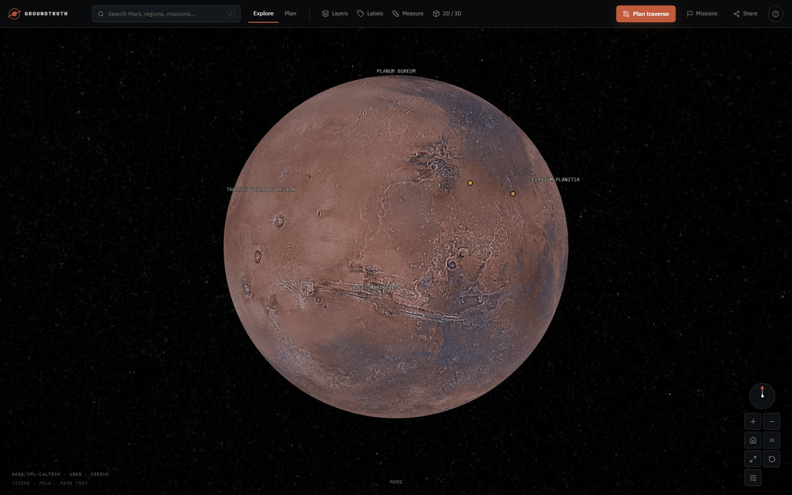
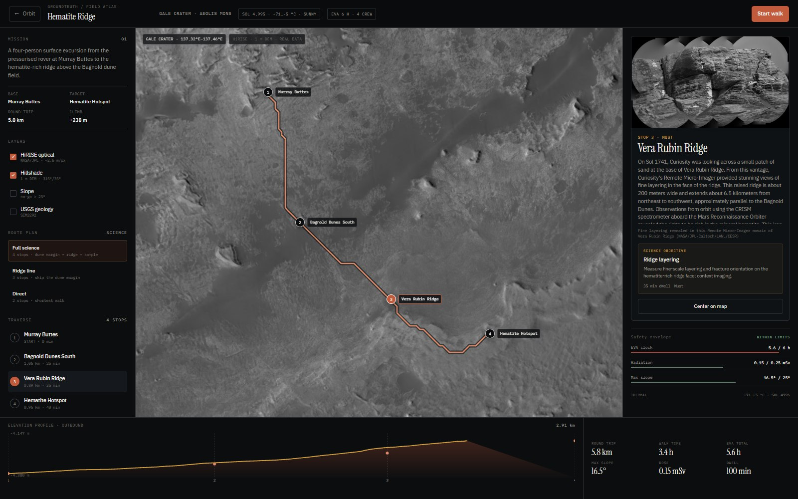
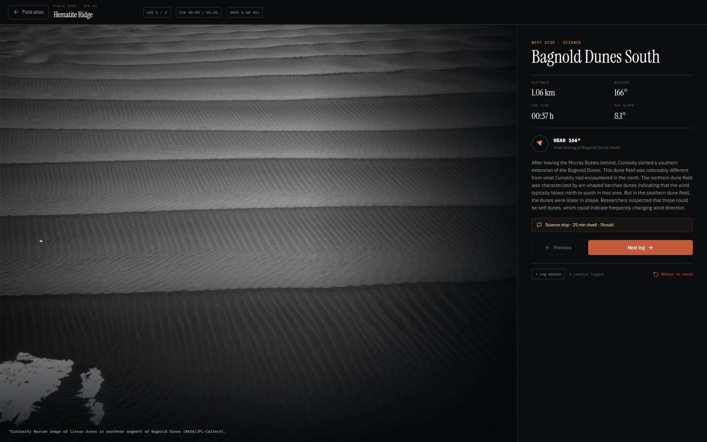

# Groundtruth — Mars Orbital Atlas

A Google Earth–style Mars globe with a real field atlas for planning a human surface excursion at Gale Crater. Built for the **NASA Space Apps Challenge 2026** — *Interplanetary Survival Guide: Martian Map*.



## What it does

**Orbit.** A 3D Mars globe with real Tycho-2 stars, global Viking imagery, named regions, MC quadrangles, major features, landing sites, and rover traverses. Hover a region to reveal its boundary; click to fly in. Search any of 1,794 named features, 34 regions, 30 quadrangles, or 8 landing sites.

**Understand.** Each place opens a field card with real NASA imagery, coordinates, data resolution, and a short description. Feature cards use the Mars Trek gazetteer content; landing-site cards identify the mission.

**Plan.** The Gale Crater field atlas combines HiRISE optical imagery, a 1 m DEM, hillshade, slope classes, and USGS geology. Three route plans (Full science, Ridge line, Direct) recompute distance, climb, walk time, radiation dose, and the safety envelope from the DEM. The route itself is an A* least-cost path on a ~24 m navigation grid with a 25° slope no-go.



**Walk.** Field mode turns the plan into leg cards with bearing, distance, leg time, slope, EVA clock, dose, and the real Mastcam/Navcam view of the next stop.



## Run it

```bash
pnpm install
pnpm dev
```

Open `http://127.0.0.1:5173`.

Production:

```bash
pnpm build
pnpm preview
```

The build is a static site. `pnpm dev` and `pnpm build` copy the Cesium runtime from `node_modules/cesium` into `public/cesium`; that directory is generated and gitignored.

Requirements: Node 20+ and pnpm 11+.

## Data

| Layer | Source | Resolution |
|---|---|---|
| Global Mars basemap | NASA/JPL Mars Trek — Viking MDIM21 colour mosaic | 232 m/px |
| Gale optical | NASA/JPL/UArizona HiRISE mosaic via Mars Trek | ~2.6 m/px export |
| Gale terrain | NASA/JPL/USGS Gale DEM via Mars Trek | ~5.9 m/px exported grid |
| Hillshade / slope | Derived from the DEM | 5.9 m/px |
| Geology | USGS Astrogeology `SIM3292_Global_Geology` | regional |
| Regions / quadrangles | NASA Mars Trek `mars_regions`, `mc5m_quadsdd_dense` | vector |
| Named features | IAU/USGS Gazetteer via Mars Trek | 1,794 points |
| Landing sites / traverses | NASA/JPL Mars Trek | vector |
| Weather | NASA/JPL-Caltech/CAB MSL REMS | latest sol |

Data is baked locally under `public/data` and committed with the repo. The app does not need a runtime API call after load. The Cesium runtime is generated from `node_modules` at dev/build time.

### Regenerate data

```bash
node scripts/fetch-globe.mjs
node scripts/fetch-gale.mjs
python scripts/process-gale-dem.py
```

`process-gale-dem.py` needs Python 3 with `numpy` and `Pillow`.

## How it works

- **CesiumJS** handles the globe. `Cesium.Ellipsoid.MARS` is the same EPSG:104905 ellipsoid used by Mars Trek. Cesium's camera is created with WGS84, so the app binds the camera's internal ellipsoid to Mars; without that, close views recurse inside the Earth ellipsoid.
- **Sector hit-testing** is done in JavaScript: the cursor ray is intersected with the globe, then tested against the real region polygons. This avoids relying on Cesium polygon fill/pick behaviour on a custom ellipsoid. Region outlines render as Cesium polygon outlines only while hovered or selected.
- **The field atlas** is Leaflet with `L.CRS.EPSG4326`, a HiRISE image overlay, DEM-derived hillshade/slope, and a custom route strip.
- **Routing** is A* on a ~24 m grid built from the 1 m DEM. Slope cost rises quadratically above 10°, cells above 25° are blocked, and the path is sampled back onto the DEM for distance, climb, slope, and walk time.
- **Route metrics** use Mars radius 3,389.5 km for distance, the exported DEM for elevation and slope, a Tobler-style suit-speed model, a 10 min/hour rest allowance, and a 0.026 mSv/hour radiation planning rate derived from the MSL RAD surface baseline.
- **The safety envelope** is a planning model, not a flight rule: 6 h EVA, 0.25 mSv per EVA mission rule, 25° slope no-go, and a 09:00–16:00 LMST thermal window.

## Honest limits

- The globe is a **smooth ellipsoid with imagery**, not a global 3D terrain mesh. A local Gale 3D heightmap is a deferred post-core add; the hooks are documented in `PLAN.md` §8.9.
- Global imagery is 232 m/px. HiRISE detail exists only at Gale; other regions are reconnaissance.
- The field-atlas route is **terrain-aware A\*** on a ~24 m planning grid, not a rock-scale obstacle map. Boulders and features smaller than a cell are not resolved; the 1 m HiRISE image is used for human context, not collision geometry.
- Radiation and thermal values are **planning heuristics** with cited inputs, not measured crew dose or suit thermal simulation.
- The latest REMS sol in the public API lags the rover's current sol; the app labels the actual sol returned.
- The app uses the real NASA/JPL content and imagery, but the pressurised-rover base and four-person EVA are a hypothetical mission frame.

## Credits

- NASA/JPL-Caltech Mars Trek, including the Viking/MOLA global mosaics, Gale HiRISE mosaic and DEM, regions, nomenclature, landing sites, and rover traverses.
- NASA/JPL-Caltech/University of Arizona — HiRISE.
- NASA/JPL-Caltech/USGS/ESA — MOLA/HRSC blend.
- USGS Astrogeology Science Center — planetary geologic map.
- NASA/JPL-Caltech/MSSS — Curiosity Mastcam/Navcam imagery and waypoint content.
- NASA/JPL-Caltech/CAB — MSL REMS weather.
- CesiumJS (Apache 2.0), Leaflet (BSD-2-Clause).
- Radiation baseline: Hassler et al., *Science* (2014), MSL RAD.

## AI disclosure

Built with an AI coding agent using the project plan in `PLAN.md`; all data sources and limitations are documented above.
