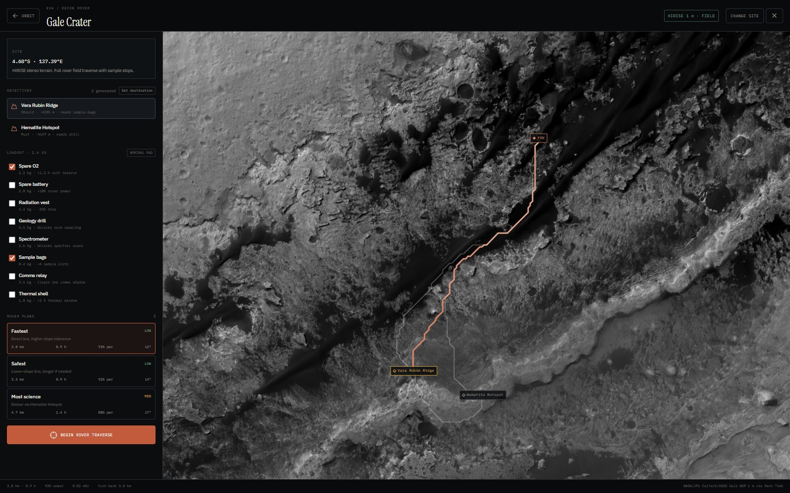
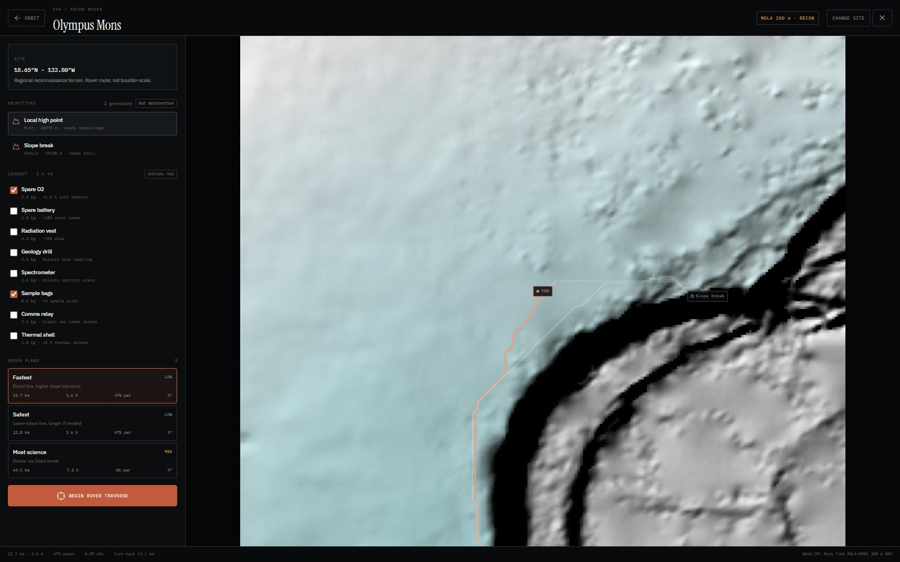

# Groundtruth — Mars Orbital Atlas + EVA

A Google Earth–style Mars globe with a Google Maps–style EVA planner anywhere on the surface. Built for the **NASA Space Apps Challenge 2026** — *Interplanetary Survival Guide: Martian Map*.


## What it does

**Orbit.** A 3D Mars globe with a sparse generated starfield, named regions, MC quadrangles, major features, landing sites, and rover traverses. Hover a region to reveal its boundary; click to fly in. Search any of 1,794 named features, 34 regions, 30 quadrangles, or 8 landing sites.

The globe uses three imagery levels: a sharpened, MOLA-relief-baked 4K base, streamed 232 m/px Mars Trek tiles at regional zoom, and true HiRISE detail over Gale. Curiosity's traverse is on by default and resolves as you descend into the crater. Outside Gale, zoom is capped at 300 km because the global source is only 232 m/px; inside Gale it goes to 2.5 km.

Lighting follows the real Mars sun. A Mars24 solar-position model drives the directional light and terminator from the current UTC instant; the HUD shows the subsolar longitude, solar longitude, and Mars Coordinated Time. The **Sun** tool switches to even studio lighting when you want to inspect the globe without a terminator; a thin screen-space atmosphere rim and a subtle grade complete the orbital look.

**Understand.** Each place opens a field card with real NASA imagery, coordinates, data resolution, and a short description. Feature cards use the Mars Trek gazetteer content; landing-site cards identify the mission.

**EVA anywhere.** Press **EVA**, pick any point on the globe, search a named feature, or enter coordinates. Groundtruth fetches a local 200 m MOLA/HRSC DEM window, builds a local map and an A* rover network, and generates terrain-grounded field objectives. Gale is the 1 m field showcase: HiRISE terrain, real Vera Rubin/Hematite objectives, and sample stops.

The planner is a Google Maps loop with consequences: choose an objective, pack equipment, compare **Fastest / Safest / Most science** rover plans, check power/dose/slope, then run the traverse leg by leg and close the EVA with a graded field log.



**Recon rover anywhere.** Outside Gale, the planner uses the global 200 m MOLA/HRSC terrain and shows `MOLA 200 m · RECON`. A **25 / 50 / 100 / 200 km range** selector fetches a wider DEM and basemap window around the astronaut, so the map is never a single tiny tile. Generated objectives are constrained to a playable operating radius inside that window. Universal layers — **Optical, Terrain, Relief, Slope, Geology** — can be combined for route context; they work at Gale and at arbitrary sites.

It plans regional rover routes, not boulder-scale walking routes — the data grade is always visible. Landing sites, Olympus, Valles, Hellas, Elysium, or any clicked point all work.



## Run it

```bash
pnpm install
pnpm dev
```

Open `http://127.0.0.1:5173`.

Production:

```bash
pnpm build
pnpm preview
```

The build is a static site. `pnpm dev` and `pnpm build` copy the Cesium runtime from `node_modules/cesium` into `public/cesium`; that directory is generated and gitignored.

Requirements: Node 20+ and pnpm 11+.

## Data

| Layer | Source | Resolution |
|---|---|---|
| Global Mars basemap | NASA/JPL Mars Trek — Viking MDIM21 colour mosaic | 232 m/px; sharpened 4K static |
| Global terrain anywhere | Mars Trek MOLA/HRSC blended DEM | 200 m/px, Float32 GeoTIFF window |
| Recon local basemap | Mars Trek MOLA/HRSC colour shaded relief | 200 m/px |
| Relief shading | NASA/JPL/USGS MOLA/HRSC blended shade | 200 m/px, baked into the 4K base |
| Starfield | Procedural, deterministic | 170 distant points + 11 brighter lights |
| Sun position | NASA GISS Mars24 (Allison & McEwen 2000) | real-time subsolar point |
| Regional globe LOD | Mars Trek `exportImage` tiles | 512 px, levels 5–9 |
| Gale field terrain | NASA/JPL/UArizona HiRISE stereo DEM via Mars Trek | 1 m source · 5.9 m grid |
| Gale field imagery | NASA/JPL/UArizona HiRISE mosaic via Mars Trek | native HiRISE |
| Hillshade / slope | Derived from the active DEM | 5.9 m (Gale) / 200 m (recon) |
| Geology | USGS Astrogeology `SIM3292_Global_Geology` | regional |
| Regions / quadrangles | NASA Mars Trek `mars_regions`, `mc5m_quadsdd_dense` | vector |
| Named features | IAU/USGS Gazetteer via Mars Trek | 1,794 points |
| Landing sites / traverses | NASA/JPL Mars Trek | vector |
| Weather | NASA/JPL-Caltech/CAB MSL REMS | latest sol |

Gale field data is baked under `public/data` and committed. Recon terrain and imagery are fetched on demand from Mars Trek for the selected site. The Cesium runtime is generated from `node_modules` at dev/build time.

### Regenerate data

```bash
node scripts/fetch-globe.mjs
node scripts/fetch-gale.mjs
python scripts/process-gale-dem.py
python scripts/sharpen-globe.py
python scripts/bake-relief.py
```

`process-gale-dem.py`, `sharpen-globe.py`, and `bake-relief.py` need Python 3 with `numpy` and `Pillow`.

## How it works

- **CesiumJS** handles the globe. `Cesium.Ellipsoid.MARS` is the same EPSG:104905 ellipsoid used by Mars Trek. Cesium's camera is created with WGS84, so the app binds the camera's internal ellipsoid to Mars; without that, close views recurse inside the Earth ellipsoid.
- **Sector hit-testing** is done in JavaScript: the cursor ray is intersected with the globe, then tested against the real region polygons. This avoids relying on Cesium polygon fill/pick behaviour on a custom ellipsoid. Region outlines render as Cesium polygon outlines only while hovered or selected.
- **Globe LOD** uses a 4K static base, 512 px `exportImage` tiles from Mars Trek at levels 5–9, and a Gale HiRISE layer from level 8. The zoom controller tightens the minimum altitude over Gale and blocks over-zoom elsewhere.
- **Sky and sun** use a deterministic sparse starfield (no cubemap seams); the Mars24 algorithm drives a directional light and a sun sprite from the live subsolar point, with a delayed re-apply to beat Cesium's first-frame light uniform. A screen-space atmosphere rim is scaled from the projected globe radius. The **Sun** tool turns lighting off for an evenly lit globe.
- **Site selection** is global: a Cesium click, named feature, landing site, or coordinate becomes the astronaut site. The beacon moves there; no Plan tab.
- **Recon terrain** is fetched per site and range: a 512–1024² Float32 GeoTIFF from Mars Trek's MOLA/HRSC 200 m DEM, plus a 1024–2048 px optical/terrain image pair. `geotiff.js` parses it in the browser; results are cached by site and range. Gale uses the baked 1 m DEM and HiRISE.
- **Universal layers** are generated per window: Viking optical, MOLA colour terrain, MOLA relief, a client-side slope raster derived from the DEM, and USGS geology. Gale substitutes its baked HiRISE/hillshade/slope/geology layers.
- **Rover routing** runs A* on a downsampled navigation grid built from whichever DEM is active. Fastest, Safest (lower slope cap), and Most science (detour via the second generated target) use different cost/constraint profiles. Rover time adds a slope-dependent speed and dwell; power is a distance/mass model; dose is time × 0.026 mSv/h.
- **Generated objectives** for arbitrary sites come from the DEM itself: local high point and steepest sampled slope break. Gale uses the real Vera Rubin Ridge and Hematite Hotspot waypoints. Generated objectives are labelled as generated.
- **The EVA loop** is: site → objective → loadout → three rover plans → run leg-by-leg → sample/abort → graded field log. The loadout affects mass/power and tool gating (drill for rock samples, bags for samples).

## Performance

- The EVA feature is code-split; Leaflet, GeoTIFF, and the Traverse UI load on demand. The site picker stays eager and the EVA chunk is prefetched after orbit settles.
- The 236 kB Mars search index loads on first focus, not at startup.
- Cesium runs render-on-demand: idle GPU work stops, and camera/hover/label/sun changes explicitly request frames.
- Globe tessellation is tuned (`maximumScreenSpaceError` 0.9, tile cache 150); the sector entity layer is deferred until after first paint.
- Recon terrain and range windows are fetched per site and cached in memory. Range and layer data load only when selected.

Measured in a headless production build: first globe canvas ~2.8 s, EVA picker ~1.8 s, Olympus terrain+routes ~7 s. Hardware-accelerated browsers are faster; global terrain fetch is network-bound.

## How it maps to the brief

| Brief ask | Implementation |
|---|---|
| A map, tool, or interface for a surface exploration mission | Any-site EVA planner: globe site picker → local map → rover plan → run/debrief |
| Science goals and a chosen location | Gale: Vera Rubin Ridge / Hematite Hotspot; arbitrary sites: generated high-point and slope-break objectives |
| At least three kinds of data | Global 200 m DEM, Viking optical basemap, MOLA shaded relief, Gale HiRISE optical, REMS weather |
| Radiation / space weather | Solar-event ×3 toggle; radiation vest −35%; 0.25 mSv EVA rule |
| Suit and equipment mobility | Pack mass changes rover power; drill/spectrometer/sample-bag tool gating; spare O2/battery |
| Thermal environment | REMS min/max; thermal shell item |
| Obstacles and safe routing | A* slope cost, 25° hard no-go, lower-slope “Safest” profile |
| Route map | Three rover plans with distance, time, power, dose, max slope, turn-back |
| Point-of-view imagery | Real Curiosity POV at Gale field stops |
| Rover / robotic support | Recon rover is the default anywhere; regional route, no boulder-scale claim |
| Inspiration from other missions | Google Maps, Death Stranding, Subnautica, Pacific Drive, Kerbal |

## Still open

- **Rock-scale obstacles.** Recon is 200 m; Gale is 1 m. Neither is a segmented boulder collision map.
- **1 m terrain everywhere.** Public global data is 200 m; only featured sites get field-grade detail.
- **Full rover systems.** Cargo, forward caches, repairs, and long campaigns are P1.
- **Science contracts/unlocks.** The current loop has generated objectives and a grade, not yet a full contract board.
- **Live space weather.** Solar events are scenarios, not a real-time feed.
- **Per-crew task assignment.** Pairs are modelled, not individually tasked.

## Honest limits

- The globe is a **smooth ellipsoid with imagery**, not a global 3D terrain mesh.
- **Anywhere means reconnaissance:** the planner fetches a 200 m MOLA/HRSC DEM window and plans a regional rover traverse. It does not resolve boulders or metre-scale scarps outside high-res sites.
- **Gale means field:** the baked 1 m DEM and HiRISE support detailed sample-stop planning, but the rover energy/dose model is still a planning model.
- Recon terrain requires network. Gale field data is baked; the global 4K base still renders offline.
- Radiation, rover power, and thermal values are **planning heuristics**, not measured crew telemetry.
- The pressurised-rover campaign and four-person crew are a hypothetical mission frame.

## Credits

- NASA/JPL-Caltech Mars Trek, including the Viking/MOLA global mosaics, Gale HiRISE mosaic and DEM, regions, nomenclature, landing sites, and rover traverses.
- NASA/JPL-Caltech/University of Arizona — HiRISE.
- NASA/JPL-Caltech/USGS/ESA — MOLA/HRSC blend and shaded relief.
- NASA/GISS Mars24 — Allison & McEwen (2000) solar-position algorithm.
- USGS Astrogeology Science Center — planetary geologic map.
- NASA/JPL-Caltech/MSSS — Curiosity Mastcam/Navcam imagery and waypoint content.
- NASA/JPL-Caltech/CAB — MSL REMS weather.
- CesiumJS (Apache 2.0), Leaflet (BSD-2-Clause), geotiff.js (MIT).
- Radiation baseline: Hassler et al., *Science* (2014), MSL RAD.

## AI disclosure

Built with an AI coding agent; all data sources and limitations are documented above.
